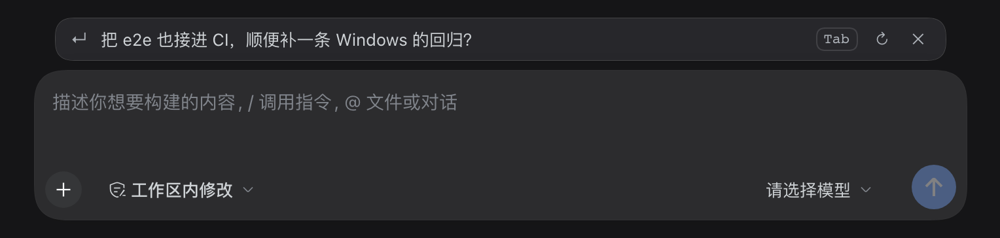

# Composer prefill


[简体中文](README.md) · **English**

[](https://www.npmjs.com/package/@wangxiaocuo/dsh-composer-prefill)
[](https://github.com/wangxiaocuo/dsh-composer-prefill/actions/workflows/ci.yml)
[](LICENSE)
[](package.json)

When an assistant turn ends, a suggestion appears above the composer with the next message you would probably type. Press `Tab` or click it to fill the draft. It never sends anything for you.



*A real window; the suggestion text was stubbed so the capture spends no model call.*

[Repository](https://github.com/wangxiaocuo/dsh-composer-prefill) · [Issues](https://github.com/wangxiaocuo/dsh-composer-prefill/issues) · [CHANGELOG](CHANGELOG.md) · [MIT](LICENSE)

> The [Chinese README](README.md) is the primary edition; this file mirrors it.

---

## Install

In the app, open **Settings → Plugins → Install** and paste the package name:

```
@wangxiaocuo/dsh-composer-prefill
```

To develop against a local checkout, paste the repository's absolute path instead; the install links to that checkout, and [Development](#development) covers the reload.

With the CLI installed, that is the same as:

```bash
dsh plugin add @wangxiaocuo/dsh-composer-prefill

# non-default profile: --profile goes before add
dsh plugin --profile <name> add @wangxiaocuo/dsh-composer-prefill
```

After installing there are two entry points:

- **Settings → General**: a "Composer predictions" switch. It applies immediately and stores the choice in the profile.
- **Settings → Plugins → Composer predictions → Configuration**: the other nine fields.

Runtime: DeepSeek Harness `0.2.2-rc.1` (see `engines.dsh`). The plugin runs on the Node that DSH itself ships; local development and tests need Node 22.13+ (why, in [Development](#development)).

## Usage

| Moment | What happens |
|---|---|
| Assistant turn ended, composer empty | One suggestion appears: single line, conversation language, the prompt asks for ≤100 characters |
| `Tab` or click the text | Fills the draft, sends nothing, and stays editable |
| `↻` | Another one: skips the cache and the interval and forces a fresh generation, one model call. Shows "Asking for another…" while it runs; an empty result keeps the current text |
| `Esc` or `✕` | Hidden for this turn. Typing and clearing will not bring it back |
| Start typing | Hides at once and aborts the in-flight request, so the call is not spent |
| Delete what you typed | The suggestion returns instantly from local state, with no request |
| Switch away and back | A cached suggestion for the current turn returns instantly (zero model calls). If the session gained records meanwhile (usually a turn that finished in the background), one is generated. With neither, nothing shows and nothing is generated |
| Submit | The next suggestion arrives after that turn ends |
| The model sees no plausible next message | It answers `NONE`; nothing shows |

The UI is one muted row above the composer: `↵` on the left, a `Tab` keycap, reroll and dismiss on the right. It is the order-15 row in `conversation.input.dock` and takes no space inside the composer.

## Configuration

The master switch lives on the **Settings → General** row. The rest live in the Plugin Manager's configuration form.

| Field | Default | Meaning |
|---|---|---|
| `showPredictions` | `true` | Master switch. Off means zero model calls |
| `provider` | `""` | Provider route for predictions; empty follows the current session |
| `model` | `""` | Model id for predictions. `provider` and `model` must both be set to take effect |
| `maxContextTurns` | `4` | Recent turns sent as context (1-20) |
| `includeToolActivity` | `true` | Tool names, short targets and ok/error from the last turn, never tool output |
| `maxInputChars` | `4000` | Character budget for the context |
| `maxOutputTokens` | `96` | Output token budget |
| `timeoutMs` | `8000` | Give up after this long, which means showing nothing |
| `minIntervalMs` | `1500` | Minimum gap between requests |
| `debug` | `false` | Emit `[composer-prefill]` diagnostics to the Host log |

## Cost and privacy

- Only the session you are looking at generates. A session you never open costs nothing, and a session that finished a turn in the background does not generate on its own; one call catches it up when you switch back.
- Each turn adds one request of roughly 3-5k input tokens and a few dozen output tokens. It never enters the transcript, the token meter or the context window, but the provider bills it.
- Context is the last N **human** `user` / `assistant` turns. Harness-injected messages (runtime-context, skill-catalog, time-context) also carry `role:user` and are filtered out here. Long messages keep both ends because the closing question usually sits at the end, and the first user request rides along as a task anchor.
- Tool calls contribute their name, a short target and ok/error, never their output. Images, attachments and reasoning are stripped.
- The provider and model follow the session and never cross providers.
- Model output is treated as untrusted: first line only, quotes stripped, length-capped, inserted only when you accept it, never auto-sent.

## How it works

```
Browser client half                              Host half
┌────────────────────────────────┐               ┌──────────────────────────────────┐
│ conversation.input.dock row    │ ────────────▶ │ /composer-prefill/predict        │
│ useInput / useSessionStatus    │               │ Host/Origin fence + owner check  │
│ AbortController (typing)       │ ◀───────────  │ LRU cache by (session, seq)      │
│ inputActions.insertText(span)  │               │ deriveMessages() last N turns    │
│                                │               │ one small ctx.llm call           │
└────────────────────────────────┘               └──────────────────────────────────┘
```

The browser half docks a row into `conversation.input.dock` and uses `useInput` and `useSessionStatus` to decide when to ask. The first keystroke aborts the in-flight request through an `AbortController`. The Host half registers two exact routes on `ctx.webServer`, runs them through the same-origin, owner and CSRF checks, keeps a 32-entry cache keyed by `(session, seq)`, and makes one small `ctx.llm` call over the last N turns.

Callers outside the browser half have two endpoints.

| Endpoint | Request | Response |
|---|---|---|
| `POST /composer-prefill/predict` | `{ sessionId, mode? }`, `mode` being `view`, `refresh` or `cached` | `{ ok: true, value: { enabled, text, cached? } }` |
| `POST /composer-prefill/prefs` | `{}` | `{ ok: true, value: { enabled, entryId } }` |

Both routes require the same-origin cookie, the owner principal and the `x-dsh-composer-prefill: 1` header, cap the body at 16 KiB and answer 405 to anything but POST. The `prefs` route tells the Settings → General row whether predictions are on and which Loader entry id owns the config form; the write goes through DSH's settings document into the profile's `cordis.patch.yml`, overriding the base plugin-manager configuration.

The four request shapes:

| mode | Use |
|---|---|
| absent | The normal request after a turn; the model is called only on a cache miss |
| `view` | Opening or switching back to a session: replays a cached suggestion for the current offset; generates exactly one when the session gained records since the last ask (usually a turn finished in the background); otherwise does nothing |
| `refresh` | `↻`: bypasses the cache and the interval and replaces the cached entry. The Host counts `attempt` and, from the second one, asks the model for a different angle instead of repeating the obvious answer |
| `cached` | Cache-only replay that never generates. Kept for API callers; the browser now uses `view` |

`Tab` is a guarded enhancement: a bubble-phase listener that claims the key only when the row is visible, focus is inside `[data-composer-card]`, there is no input method or modifier, and no slash or `@` menu consumed it (`defaultPrevented`). Clicking is the supported path.

## Prompt

The system prompt lives in [`prompt.txt`](prompt.txt) and is re-read by modification time on every call. An edit applies to the next turn with no restart; a missing or empty file falls back to the built-in prompt.

Besides the last few turns, the payload carries:

```json
{
  "task": "the user's original request (an anchor on long sessions, omitted when already in turns)",
  "language": "Chinese / English / … (from the script of the latest user messages)",
  "turns": [{ "role": "user", "text": "…" }, { "role": "assistant", "text": "…" }],
  "actions": [{ "name": "bash", "target": "pnpm test", "status": "ok" }],
  "attempt": 1,
  "previous": "the suggestion already shown on a reroll"
}
```

The prompt turns those fields into a decision procedure. Classify the assistant's last move first (a question, a delivered result, a blockage, an explanation), then ground the message in a concrete file, command, error or option and mirror the user's voice. A reroll must take a different branch rather than reword the previous line. Positive and negative examples sit in the file. Output is one line, in the conversation language, at most 100 characters; the code also strips quotes and bullets, keeps the first line and caps the result at 200 characters.

## Known limits

- The suggestion sits above the composer; there is no inline ghost text at the caret. That would mean measuring and cloning the Lexical editor DOM, which breaks under a theme or zoom change.
- `Tab` relies on the internal `[data-composer-card]` DOM contract.
- Latency is one real model call, about 1-3 seconds from request to row.
- Only the `0.2.2-rc.1` API generation is targeted. A DSH upgrade needs a regression pass, including `[data-composer-card]` and the English aria-labels the plugin uses.
- `client.js` is loaded by the Host loader and is outside `tsc --checkJs`; only the Host half (`index.js` and `lib/**`) is typechecked.
- The browser e2e stubs the prediction response through route interception, so it proves the client state machine inside the real shell and does not cover model output quality.

## Roadmap

- 0.1.x: skeleton and the suggestion row (M0/M1)
- 0.2.0: real model call, cache/coalescing/throttling, cached replay on switch, restore when the draft is cleared
- 0.3.0: `↻ another one`, the Settings → General switch
- 0.3.1: the switch persists (`volatile`); real-host and browser e2e join CI and the release gate
- 0.4.0: catch-up predictions on switching back to a session (`view` mode)
- 0.4.1: prompt and payload v2 (injected-context filtering, head and tail clipping, task anchor, tool actions, language, reroll de-duplication)
- 0.4.2: new plugin icon
- 0.5.0 (optional): inline ghost text, candidate cycling on the row

## Development

### Layout

```
index.js             Host: Config + route registration
lib/http.js          Same-origin endpoints, fence/owner/CSRF checks, body reading
lib/predictions.js   Cache, request coalescing, throttling, RPC handler
lib/generate.js      One ctx.llm call (route, context, output hygiene)
lib/prompt.js        Context trimming, output sanitising, hot-reloaded prompt
lib/config.js        Config readers (schemastery refs or plain values)
client.js            Browser half: the row, trigger state machine, Tab/Esc, accept
prompt.txt           System prompt
test/                Unit tests, Host smoke, browser-half DOM, real-host e2e
```

A `client.js` change needs a page reload. An `index.js` or `lib/*.js` change needs a **quit and reopen**: this desktop build ships no Host-side module replacement, and Node caches ES modules for the process lifetime.

```bash
pnpm install
pnpm typecheck        # tsc --checkJs (index.js + lib/**)
pnpm test             # unit tests (node:test, Host lib + browser-half DOM)
pnpm test:coverage    # coverage floor on lib/** (same flags as CI)
pnpm test:smoke       # endpoint end-to-end (real Cordis wiring, scripted model)
pnpm test:e2e         # real dsh web + headless Chromium
pnpm pack:check       # verify the npm tarball file list
pnpm verify           # typecheck + test + smoke + pack:check; also runs on prepublishOnly
```

### Tests

Both real-host suites share [test/e2e/harness.mjs](test/e2e/harness.mjs): it locates a runnable Harness CLI (the local desktop app, or the npm-installed `@deepseek-ai/dsh` that `DSH_E2E_DSH_BIN` points at), generates a `web` profile in a throwaway `DSH_HOME` with this repository `link:`-installed, boots the real `dsh web`, and redeems the launch token for a browser cookie.

- [test/e2e-host.mjs](test/e2e-host.mjs) exercises the real HTTP surface: the plugin loads in a real Host, `prefs` returns the config and entry id, the settings document holds the plugin's namespace and the switch persists both ways, predicting for an unopened session makes no model call, and the 405/403/400 fences plus the 16 KiB cap hold.
- [test/e2e-browser.mjs](test/e2e-browser.mjs) drives the real UI with Playwright and headless Chromium: the row appears from a `view` replay, a click fills the draft, clearing restores it locally, `↻` sends `refresh`, `✕` suppresses the row across typing and clearing, and the Settings → General switch writes through to the Host.

The browser suite fulfils `/composer-prefill/predict` through Playwright routing, so it verifies the client state machine inside the real shell without spending a model call; the real endpoint is covered by the host suite. The first run needs `pnpm exec playwright install chromium`. With no runnable Harness it prints a skip message and exits 0.

`client.js` is a DSH module-loader script (`window.__ModuleLoader__.load` plus `factory(require)`) and cannot be imported as ESM, so it is not typechecked; `test/client-dom.test.mjs` covers its behaviour under jsdom.

### CI and releases

CI runs on GitHub Actions ([ci.yml](.github/workflows/ci.yml)); releases are tag-triggered ([release.yml](.github/workflows/release.yml)).

| Check | Environment |
|---|---|
| `tsc --checkJs` (`index.js` + `lib/**`) | Ubuntu Node 22 / 24 |
| Unit tests and the Host smoke test | Ubuntu Node 22 / 24, Windows Node 22 |
| Coverage floor (`lib/**`) | Ubuntu Node 22 |
| Package contents (`npm pack` file list) | Ubuntu Node 22 |
| Real Host and browser e2e (throwaway `DSH_HOME`, pinned `dsh` runtime) | Ubuntu Node 24 |

The floor on `lib/**` is 95% lines, 90% branches and 95% functions. `test/run-unit.mjs` enumerates `*.test.mjs` itself instead of relying on shell glob expansion, so Windows runs the same cases.

The supported baseline is Node 22.13+: Node 20 reached end of life in April 2026, the pinned pnpm 11 cannot run below 22.13 (`node:sqlite`), and the DSH runtime this plugin loads into ships Node 24.

A release takes three steps. Bump the version in `package.json` and fold the `[Unreleased]` entries into a new `## [x.y.z] - YYYY-MM-DD` section in the CHANGELOG. Commit, push, then tag:

```bash
git tag -a vX.Y.Z -m "vX.Y.Z" && git push origin vX.Y.Z
```

The tag runs [release.yml](.github/workflows/release.yml): `pnpm release:check` (tag, `package.json` and the newest CHANGELOG version agree), then typecheck, unit tests, smoke, the pack check and both real-host e2e suites, then `npm publish --provenance` and a GitHub Release.

Publishing uses npm Trusted Publishing (OIDC), so no `NPM_TOKEN` is needed: on npmjs.com add repository `wangxiaocuo/dsh-composer-prefill` and workflow `release.yml` under the package's **Settings → Publishing access → Trusted publishers**. To use an automation token instead, uncomment the `NODE_AUTH_TOKEN` environment variable in release.yml and add the matching secret.

One maintainer trap: the `.volatile()` marker on `Config.showPredictions` must stay. Remove it and the settings switch silently stops persisting; the host e2e asserts this.

Bugs and pull requests go to [GitHub Issues](https://github.com/wangxiaocuo/dsh-composer-prefill/issues).

## License

MIT License © 2026 [wangxiaocuo](https://github.com/wangxiaocuo)
