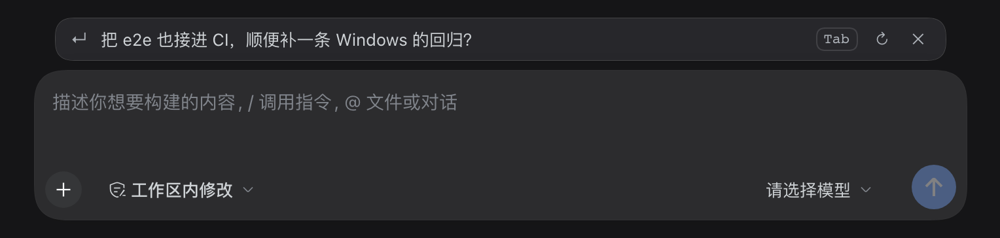

# 输入预测 · Composer prefill


[English](README.en.md) · **简体中文**

[](https://www.npmjs.com/package/@wangxiaocuo/dsh-composer-prefill)
[](https://github.com/wangxiaocuo/dsh-composer-prefill/actions/workflows/ci.yml)
[](LICENSE)
[](package.json)

助手回完一轮，输入框上方出现一条建议，内容是你大概率会打的下一句。按 `Tab` 或点一下填进草稿，不会自动发送。



*截图取自真实界面，建议文本用固定返回，截图时不调用模型。*

[仓库](https://github.com/wangxiaocuo/dsh-composer-prefill) · [问题](https://github.com/wangxiaocuo/dsh-composer-prefill/issues) · [CHANGELOG](CHANGELOG.md) · [MIT](LICENSE)

---

## 安装

在应用里打开 **设置 → 插件 → 安装**，粘贴包名：

```
@wangxiaocuo/dsh-composer-prefill
```

要在本地改代码，就粘贴仓库目录的绝对路径，装上去的就是这份 checkout，改完按[开发](#开发)里的方式重载。

装了命令行的话，等价于：

```bash
dsh plugin add @wangxiaocuo/dsh-composer-prefill

# 非默认 profile，--profile 要放在 add 前面
dsh plugin --profile <name> add @wangxiaocuo/dsh-composer-prefill
```

装好后有两个入口：

- **设置 → 通用**：一行「输入预测」开关，点了即时生效，选择写进 profile；
- **设置 → 插件 → 输入预测 → 配置**：其余 9 个参数。

运行要求 DSH `0.2.2-rc.1`（见 `engines.dsh`）。插件跟随 DSH 自带的 Node 运行；本地开发和测试要 Node 22.13+，理由写在[开发](#开发)一节。

## 用法

| 时机 | 结果 |
|---|---|
| 助手回完、输入框为空 | 出现一条建议，单行、同语言，提示词要求 ≤100 字符 |
| 按 `Tab` 或点击文字 | 填进草稿，不发送，可以接着改 |
| 点 `↻` | 换一条：跳过缓存和最小间隔，强制重新生成，一次模型调用。请求期间显示「换一条中…」，新结果为空就保留旧的 |
| 按 `Esc` 或点 `✕` | 本轮不再出现。之后打字再删空也不会回来 |
| 开始打字 | 立刻隐藏，并中止在途请求，省掉这次调用 |
| 把刚打的字删空 | 建议立刻回来，走本地状态，不发请求 |
| 切走再切回 | 缓存里有当前这一轮就立刻回显（零模型调用）；这期间会话有了新记录（通常是那一轮在后台跑完）就补生成一条；两者都没有就不显示，也不生成 |
| 提交发送 | 等这一轮结束再给下一条建议 |
| 模型判断没有合理的下一句 | 输出 `NONE`，什么都不显示 |

界面就是输入框上方的一行淡色建议，左侧 `↵`，右侧是 `Tab` 键帽、`↻` 换一条和 `✕` 忽略。它是 `conversation.input.dock` 里 order 15 的一行，不占输入框。

## 配置

总开关在 **设置 → 通用** 那一行；其余字段在插件管理器的配置表单里。

| 字段 | 默认 | 说明 |
|---|---|---|
| `showPredictions` | `true` | 总开关。关掉后零模型调用 |
| `provider` | `""` | 预测用的 provider，留空跟随当前会话 |
| `model` | `""` | 预测用的模型。`provider` 和 `model` 都填才生效 |
| `maxContextTurns` | `4` | 喂给预测的最近轮数（1–20） |
| `includeToolActivity` | `true` | 带上上一轮工具调用的名称、简短目标和成功/失败，不含工具输出 |
| `maxInputChars` | `4000` | 上下文总字符上限 |
| `maxOutputTokens` | `96` | 输出 token 上限 |
| `timeoutMs` | `8000` | 超过这个时间就放弃，等同于不显示 |
| `minIntervalMs` | `1500` | 两次请求之间的最小间隔 |
| `debug` | `false` | 往宿主日志打 `[composer-prefill]` 诊断 |

## 成本与隐私

- 只给你正在看的会话生成。没打开的会话永远不花调用；后台跑完的会话也不会自己生成，你切回去的那一刻才补一条。
- 每轮多一次请求，约 3–5k input tokens 加几十 output tokens。它不进会话记录，也不占 token meter 和上下文窗口，但 provider 照常计费。
- 上下文只取最近 N 轮的真人 `user` / `assistant` 消息。DSH 注入的 runtime-context、skill-catalog、time-context 也带 `role:user`，这里会过滤掉。长消息保留头尾，结论和追问通常在末尾；首个用户请求作为任务锚点。
- 工具调用只带名称、简短目标和成功/失败，不带工具输出；图片、附件、reasoning 一律剥掉。
- provider 和 model 跟随会话本身，不跨 provider。
- 模型输出按不可信处理：只取首行、去引号、限长，只有你显式接受才会落进草稿，绝不自动发送。

## 工作方式

```
浏览器 client 半                                  宿主 host 半
┌────────────────────────────────┐                ┌──────────────────────────────────┐
│ conversation.input.dock 建议条 │ ────────────▶  │ /composer-prefill/predict        │
│ useInput / useSessionStatus    │                │ Host/Origin 围栏 + owner 校验    │
│ AbortController（打字即取消）  │ ◀───────────   │ 按 (session, seq) 的 LRU 缓存    │
│ inputActions.insertText(span)  │                │ deriveMessages() 最近 N 轮       │
│                                │                │ ctx.llm 一次小调用（跟随会话）   │
└────────────────────────────────┘                └──────────────────────────────────┘
```

浏览器半挂在 `conversation.input.dock`，用 `useInput` 和 `useSessionStatus` 判断什么时候问；一开始打字就用 `AbortController` 掐掉在途请求。宿主半在 `ctx.webServer` 上注册两个精确路径，过同源、owner、CSRF 三道检查，缓存按 `(session, seq)` 记最近 32 条，一次 `ctx.llm` 小调用读最近 N 轮。

浏览器半之外，外部调用方可以走这两个端点。

| 端点 | 请求 | 返回 |
|---|---|---|
| `POST /composer-prefill/predict` | `{ sessionId, mode? }`，`mode` 取 `view` / `refresh` / `cached` | `{ ok: true, value: { enabled, text, cached? } }` |
| `POST /composer-prefill/prefs` | `{}` | `{ ok: true, value: { enabled, entryId } }` |

两个端点都要求同源 cookie、owner 身份和 `x-dsh-composer-prefill: 1` 头，请求体上限 16 KiB，非 POST 返回 405。`prefs` 给 设置 → 通用 那一行提供「当前开没开」和本插件的 Loader entry id；写入走 DSH 的 settings 文档，落进 profile 的 `cordis.patch.yml`，覆盖插件管理器里的基础配置。

四种请求：

| mode | 用途 |
|---|---|
| 缺省 | 回合结束后的正常请求，缓存未命中才真的调模型 |
| `view` | 打开或切回会话：缓存里有当前 offset 的建议就回显；这期间会话有了新记录（通常是那一轮在后台跑完）才补生成一条；否则什么都不做 |
| `refresh` | `↻ 换一条`：跳过缓存和最小间隔重新生成，结果覆盖缓存。宿主会带上 `attempt` 计数，第二次起要求模型换个角度，而不是重复最显然的答案 |
| `cached` | 只读回放，永不生成。留给 API 调用方，浏览器已经改用 `view` |

`Tab` 是受保护的增强：bubble 阶段监听，只在建议可见、焦点在 `[data-composer-card]` 内、非输入法、无修饰键、也没被斜杠或 `@` 菜单消费（`defaultPrevented`）时才 `preventDefault`。点击接受是主路径。

## 提示词

系统提示词在 [`prompt.txt`](prompt.txt)，每次调用按 mtime 现读。改完下一轮就生效，不用重启；文件缺失或为空时回退到内置提示。

载荷里除了最近几轮，还有这些字段：

```json
{
  "task": "用户的原始请求（长会话时作锚点，已经出现在 turns 里就不重复）",
  "language": "Chinese / English / …（按最近用户消息的文字系统判断）",
  "turns": [{ "role": "user", "text": "…" }, { "role": "assistant", "text": "…" }],
  "actions": [{ "name": "bash", "target": "pnpm test", "status": "ok" }],
  "attempt": 1,
  "previous": "换一条时已经展示过的那条"
}
```

提示词把这几个字段变成一套判断流程：先看助手最后一步是提问、交付、受阻还是解释，再要求建议落到具体的文件、命令、错误或选项上，用用户自己的语气；换一条要换分支，不能只改措辞。正反例都写在文件里。输出要求一行、同语言、不超过 100 字符；代码侧还会去引号、去列表符号、截首行，硬上限 200 字符。

## 已知限制

- 建议显示在输入框上方，光标处不做内联幽灵文本。那要测量并克隆 Lexical 编辑器的 DOM，主题和缩放一变就容易坏。
- `Tab` 依赖 `[data-composer-card]` 这个内部 DOM 约定。
- 一次真实模型调用，从请求到显示大约 1–3 秒。
- 只针对 `0.2.2-rc.1` 这一代 API。DSH 升级后需要回归，包括 `[data-composer-card]` 和插件用的英文 aria-label。
- `client.js` 由宿主 loader 直接加载，不在 `tsc --checkJs` 范围内；类型检查只覆盖宿主半（`index.js` 和 `lib/**`）。
- 浏览器 e2e 用路由拦截桩掉预测返回，验的是客户端状态机和真实外壳，不覆盖模型输出质量。

## 路线

- 0.1.x：骨架和建议条（M0/M1）
- 0.2.0：真模型调用、缓存/合并/限流、切会话缓存回显、清空草稿恢复
- 0.3.0：`↻ 换一条`，设置 → 通用 一行开关
- 0.3.1：开关真正落盘（`volatile`）；真实宿主和浏览器 e2e 进入 CI 与发版闸门
- 0.4.0：切回会话时的补预测（`view` 模式）
- 0.4.1：提示词与载荷 v2（过滤注入上下文、头尾裁剪、任务锚点、工具动作、语言、换一条防重复）
- 0.4.2：新插件图标
- 0.5.0（可选）：内联幽灵文本、建议条上的候选切换

## 开发

### 目录

```
index.js             宿主：Config + 路由注册
lib/http.js          同源端点、围栏/owner/CSRF 校验、请求体读取
lib/predictions.js   缓存、请求合并、限流、RPC handler
lib/generate.js      一次性 ctx.llm 调用（路由解析、上下文、输出消毒）
lib/prompt.js        上下文裁剪、输出消毒、提示词热读
lib/config.js        配置读取（兼容 schemastery ref 与普通值）
client.js            浏览器半：建议条、触发状态机、Tab/Esc、接受
prompt.txt           系统提示词
test/                单元测试、宿主 smoke、浏览器半 DOM、真实宿主 e2e
```

改 `client.js`，刷新页面即可。改 `index.js` 或 `lib/*.js` 要**退出并重新打开应用**：这套桌面构建没有宿主侧模块热替换，Node 的 ESM 缓存也不会因为文件变化而失效。

```bash
pnpm install
pnpm typecheck        # tsc --checkJs（index.js + lib/**）
pnpm test             # 单元测试（node:test，含宿主 lib 与浏览器半 DOM）
pnpm test:coverage    # 覆盖率门槛（lib/**，与 CI 同一套参数）
pnpm test:smoke       # 端点端到端（真实 Cordis 装配，桩模型）
pnpm test:e2e         # 真实 dsh web + headless Chromium
pnpm pack:check       # 核对 npm tarball 的文件清单
pnpm verify           # typecheck + test + smoke + pack:check；prepublishOnly 也跑它
```

### 测试

两个真实宿主套件共用 [test/e2e/harness.mjs](test/e2e/harness.mjs)：它找一个能跑的 Harness CLI（本机桌面 App，或 `DSH_E2E_DSH_BIN` 指向 npm 安装的 `@deepseek-ai/dsh`），在临时 `DSH_HOME` 里生成 `web` profile、`link:` 本仓库，启动真实的 `dsh web`，再用启动 token 换浏览器 cookie。

- [test/e2e-host.mjs](test/e2e-host.mjs) 走真实 HTTP 面：插件在真实 Host 里加载、`prefs` 返回配置与 entry id、设置文档里本插件的命名空间存在且开关双向落盘、未打开会话的 predict 不产生模型调用、405/403/400 围栏与 16 KiB 体积上限。
- [test/e2e-browser.mjs](test/e2e-browser.mjs) 用 Playwright + headless Chromium 打开真实界面：建议条从 `view` 请求回显、点击填入草稿、清空后本地恢复、`↻` 发 `refresh`、`✕` 忽略后打字再清空也不回来，以及设置 → 通用的开关写穿到宿主。

浏览器套件用 Playwright 路由拦截替换 `/composer-prefill/predict` 的响应，验的是客户端状态机加真实外壳，不消耗模型调用；真实端点由 host 套件覆盖。第一次跑要先 `pnpm exec playwright install chromium`；找不到可用的 Harness 时打印跳过信息并以 0 退出。

`client.js` 是 DSH 的 module-loader 脚本（`window.__ModuleLoader__.load` + `factory(require)`），不能当 ESM 导入，所以不参与 tsc 检查，行为由 `test/client-dom.test.mjs` 在 jsdom 里覆盖。

### CI 与发版

CI 在 GitHub Actions 上跑（[ci.yml](.github/workflows/ci.yml)），发版由标签触发（[release.yml](.github/workflows/release.yml)）。

| 检查 | 环境 |
|---|---|
| `tsc --checkJs`（`index.js` + `lib/**`） | Ubuntu Node 22 / 24 |
| 单元测试和宿主 smoke test | Ubuntu Node 22 / 24，Windows Node 22 |
| 覆盖率门槛（`lib/**`） | Ubuntu Node 22 |
| 打包内容（`npm pack` 文件清单） | Ubuntu Node 22 |
| 真实 Host 和浏览器 e2e（临时 `DSH_HOME` + pinned `dsh` runtime） | Ubuntu Node 24 |

覆盖率门槛是 `lib/**` 行 95% / 分支 90% / 函数 95%。`test/run-unit.mjs` 自己枚举 `*.test.mjs`，不靠 shell 展开 glob，所以 Windows 上跑的是同一批用例。

支持基线是 Node 22.13+：Node 20 在 2026 年 4 月 EOL，锁定的 pnpm 11 在 Node < 22.13 上起不来（`node:sqlite`），而插件实际加载的 DSH 运行时自带 Node 24。

发版分三步。先改 `package.json` 的版本，把 CHANGELOG 里 `[Unreleased]` 的条目收进新的 `## [x.y.z] - YYYY-MM-DD`。再提交推送并打标签：

```bash
git tag -a vX.Y.Z -m "vX.Y.Z" && git push origin vX.Y.Z
```

标签触发 [release.yml](.github/workflows/release.yml)：先跑 `pnpm release:check`（标签、`package.json`、CHANGELOG 最新版本三者一致），再跑类型检查、单元测试、smoke、打包校验和两个真实宿主 e2e，最后 `npm publish --provenance` 并创建 GitHub Release。

发布走 npm Trusted Publishing（OIDC），不需要 `NPM_TOKEN`：在 npmjs.com 该包的 **Settings → Publishing access → Trusted publishers** 里加上仓库 `wangxiaocuo/dsh-composer-prefill` 和 workflow `release.yml` 即可。想用自动化 token 的话，把 release.yml 里注释掉的 `NODE_AUTH_TOKEN` 打开并配上 secret。

维护者注意：`Config.showPredictions` 的 `.volatile()` 标记不能去掉，去掉了设置页开关会静默失效，host e2e 对此有断言。

问题反馈和 PR 走 [GitHub Issues](https://github.com/wangxiaocuo/dsh-composer-prefill/issues)。

## 许可

MIT License © 2026 [wangxiaocuo](https://github.com/wangxiaocuo)
